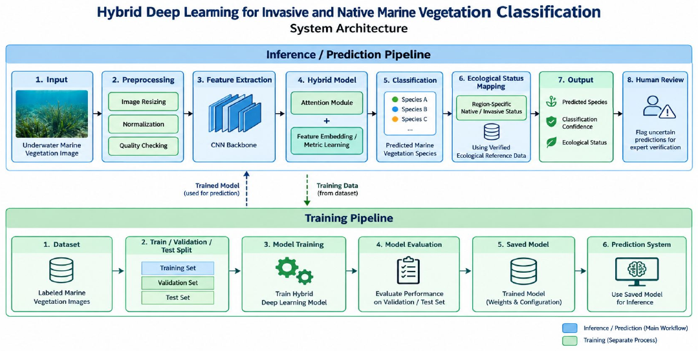
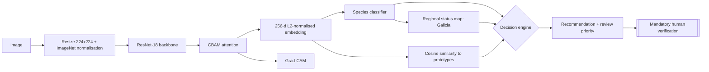
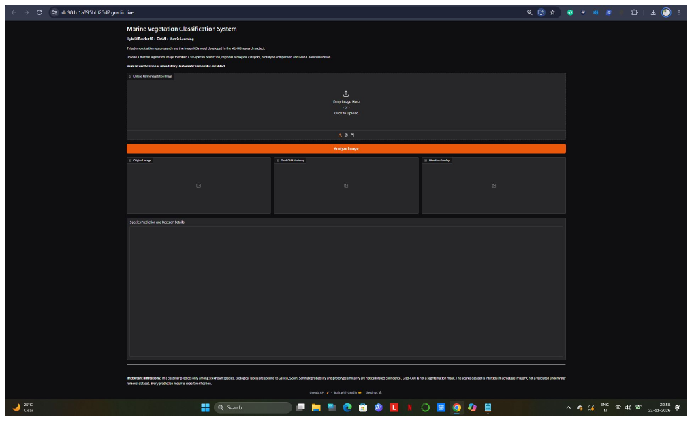
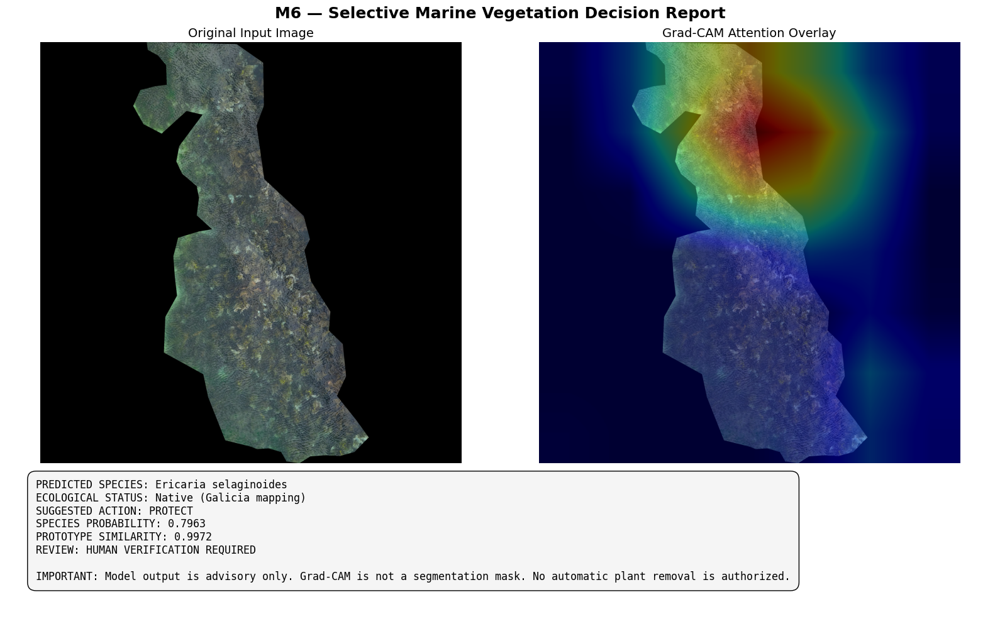

# Fine-Grained Discrimination of Invasive and Native Marine Vegetation

A hybrid deep learning pipeline (**ResNet-18 + CBAM attention + metric learning**) that classifies look-alike
macroalgae species, maps each to a regional **native / invasive** status, explains the prediction with
**Grad-CAM**, and routes every result to **mandatory human review**. Automatic removal is disabled by design.

> B.Tech Artificial Intelligence and Data Science mini-project, Saveetha Engineering College (Autonomous).
> Research use only: this is a decision-support prototype, **not** a removal system.



## Why this project

Invasive algae and seaweed threaten reefs, seagrass meadows and native biodiversity. Manual diver removal is precise
but slow; mechanical harvesting is fast but cannot tell a harmful plant from a native one. Before any selective,
autonomous removal can be considered safe, a system must reliably tell **visually similar invasive and native species**
apart, and know when it is unsure. This repository tackles that classification bottleneck.

## Headline results

| Model | Task | Evaluation data | Accuracy |
|---|---|---|---|
| ResNet-18 baseline (M2) | 4-class ECU-MSS-2 | Clean test, 1,002 images | 86.73% (validation 99.51%) |
| ResNet-18 binary (M4) | Native vs invasive | **Sealed independent test**, 422 images | 86.02% |
| Hybrid ResNet-18 + CBAM + metric learning (M5) | 6 species | Validation, 432 images | 86.81% (macro F1 0.7203\*) |
| Hybrid model (M5) | Native vs invasive | Validation, 432 images | 90.74% |

\*The six-class macro F1 includes *Asparagopsis armata*, which has no validation images and scores 0; the mean F1 over
the five species present is about 0.864.

**Read this carefully:** M5 numbers are *validation* results; the hybrid model has **not yet** been evaluated on the
sealed M4 test set, so M4 and M5 must not be compared as evidence that the hybrid is better. See
[docs/results.md](docs/results.md) and [docs/limitations.md](docs/limitations.md).

## Pipeline



## Repository layout

```
.
├── src/marine_veg/        # model (ResNet-18 + CBAM + embedding), losses, decision engine
├── notebooks/             # Mini_Project.ipynb: full M1-M6 workflow (outputs cleared)
├── docs/                  # methodology, datasets, results, architecture/UML, limitations
├── results/               # metrics_summary.json, species_ecological_mapping.csv
├── assets/                # figures used in the docs
├── tests/                 # smoke tests (random data, no datasets needed)
├── requirements.txt
└── LICENSE
```

## Quick start

```bash
git clone https://github.com/Kishore-2007/marine-vegetation-discrimination.git
cd marine-vegetation-discrimination
pip install -r requirements.txt
pytest -q            # shape / loss / safety smoke tests

# use the model definition
python - <<'EOF'
import sys; sys.path.insert(0, "src")
import torch
from marine_veg import M5HybridModel
model = M5HybridModel().eval()
out = model(torch.randn(1, 3, 224, 224))
print(out["embedding"].shape, out["logits"].shape)   # (1, 256) (1, 6)
EOF
```

The datasets and trained checkpoint are **not** included (see [docs/datasets.md](docs/datasets.md)). To reproduce the
experiments, open `notebooks/Mini_Project.ipynb` in Google Colab (GPU) and follow the milestone headings; the notebook
expects the datasets and a Google Drive working folder.

## Milestones

| ID | Milestone | Outcome |
|---|---|---|
| M1 | Data preparation and integrity audit (SHA-256, pHash + SIFT, group-aware split) | Leakage-free manifests; clean test set of 1,002 images |
| M2 | Baseline CNN (ResNet-18) | 99.51% validation but 86.73% clean-test accuracy |
| M3 | Localisation / explainability | No masks available; Grad-CAM used as a diagnostic |
| M4 | Native vs invasive baseline with sealed test | 86.02% independent-test accuracy |
| M5 | Hybrid ResNet-18 + CBAM + metric learning | 86.81% species / 90.74% ecological (validation) |
| M6 | Decision engine + Gradio interface | Human-verified, removal-disabled demonstrator |

## Interface



Decision report for a validation image:



## Key findings

- Naive evaluation overstated accuracy: duplicates between splits inflated results (89.42% initial, 99.51% on validation,
  86.73% on a clean test set).
- CLAHE enhancement did **not** improve classification (99.51% to 99.03% / 99.27%).
- Misclassified images were significantly blurrier and lower contrast.
- Softmax probability and prototype similarity are over-confident on wrong predictions, so human review stays mandatory.
- The hardest case is the invasive *Sargassum muticum* versus native brown algae such as *Saccorhiza polyschides*.

## Limitations (short version)

Intertidal / seagrass imagery rather than validated underwater data; validation-only hybrid results; Galicia-specific
labels; very few *Asparagopsis armata* images; uncalibrated confidence; no segmentation masks; no robotic deployment.
Details in [docs/limitations.md](docs/limitations.md).

## Roadmap

- Evaluate the locked hybrid model once on the sealed independent test set
- Larger, more diverse underwater datasets
- Calibrated uncertainty and unknown-species detection
- Pixel-level segmentation, then simulated and human-supervised robotic integration

## Acknowledgements

Developed under the guidance of Dr. R. Augustian Isaac, Department of AIML, Saveetha Engineering College.
Datasets: ECU-MSS-2 imagery and the Intertidal Macroalgae (IMO) dataset, Zenodo record 14185867. Please consult each
dataset's own licence and citation requirements.

## License

Code is released under the MIT License (see [LICENSE](LICENSE)). Datasets are not redistributed and keep their original licences.
