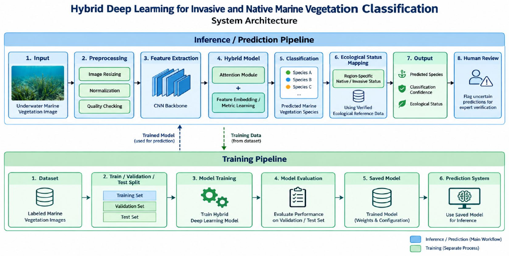
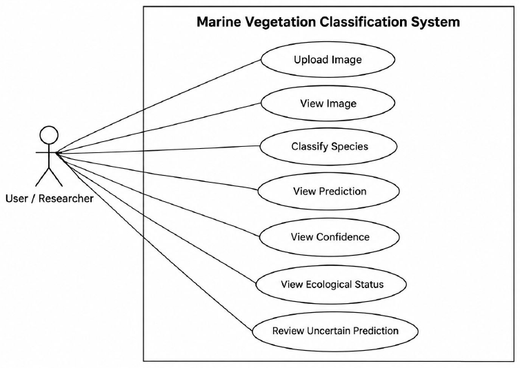
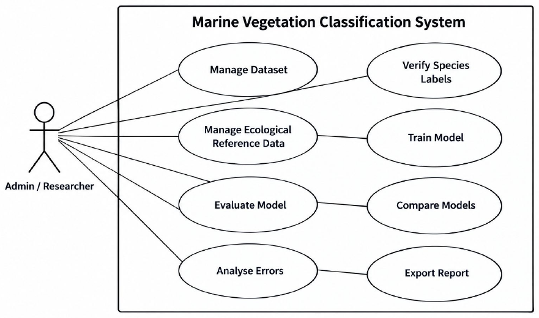
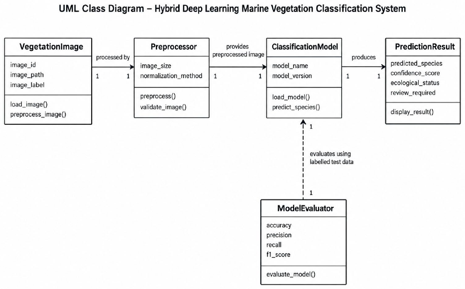
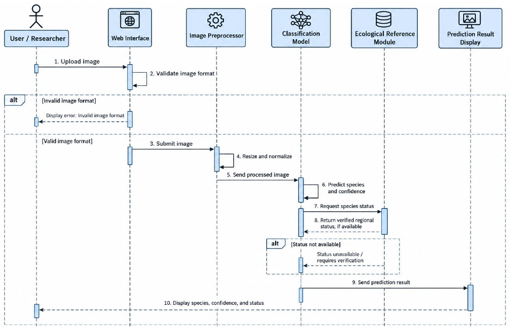
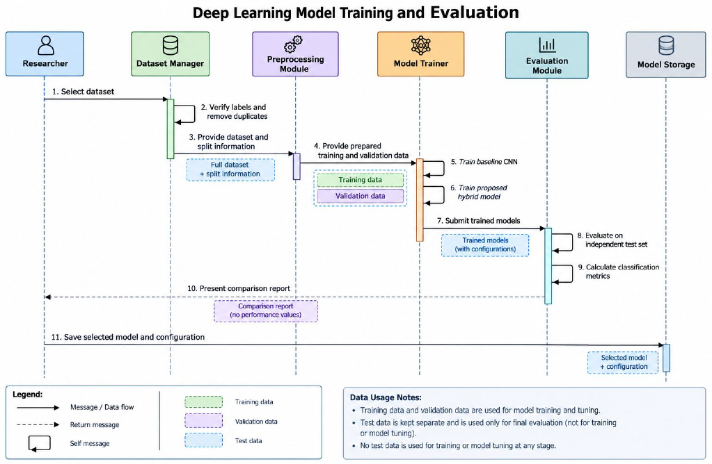
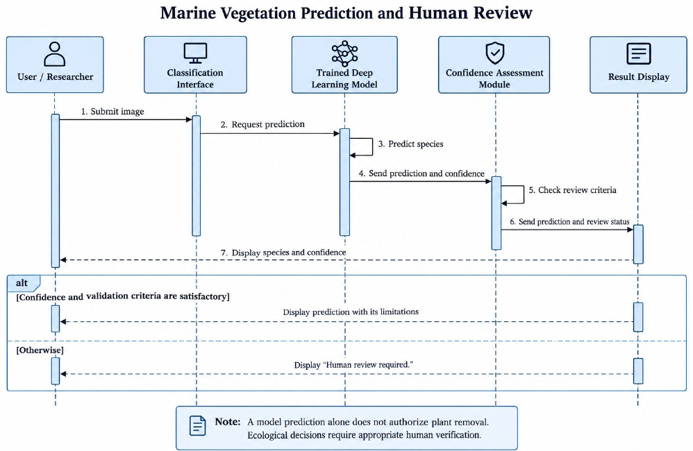
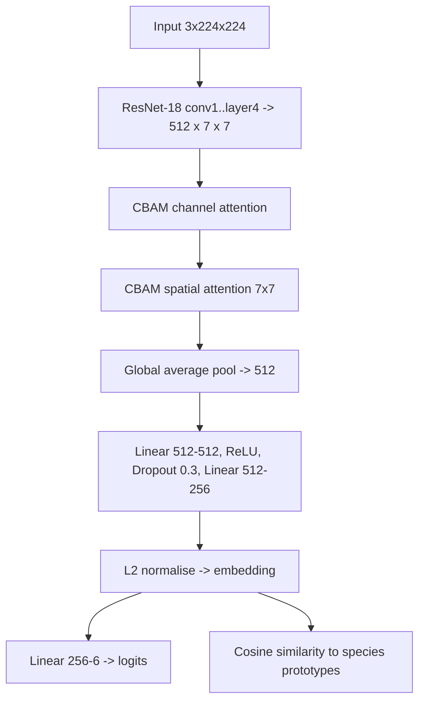

# Architecture and design

## System architecture

Two separate pipelines: training (dataset, split, train, evaluate, save) and inference (preprocess, features,
attention, classify, ecological status, output, human review).

## Use cases

## Class diagram

## Sequence diagrams

Prediction flow:

Training and evaluation (the test set is used only for final evaluation):

Prediction and human review (a model prediction alone never authorises removal):

## Model

