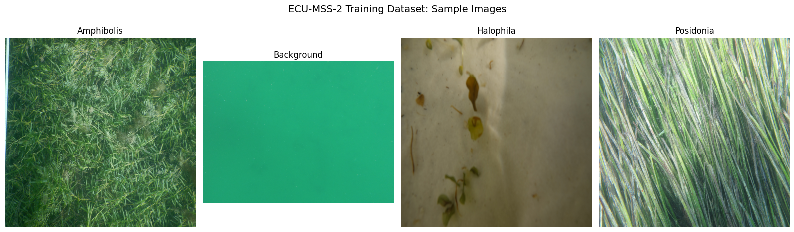

# Datasets

Datasets are **not** stored in this repository. Check each dataset's licence before reuse.

## ECU-MSS-2 (M1-M3)

Image archives for four classes: Amphibolis, Background, Halophila, Posidonia.

| Split | Amphibolis | Background | Halophila | Posidonia | Total |
|---|---|---|---|---|---|
| Training archives | 1,044 | 977 | 1,055 | 1,085 | 4,161 |
| Test archives | 260 | 260 | 260 | 260 | 1,040 |

Used for the data-integrity pipeline, baseline, enhancement and explainability experiments. It is seagrass/substrate
imagery, not an invasive-vs-native dataset.

## Intertidal Macroalgae (IMO) dataset (M4-M6)

Zenodo record **14185867**: georeferenced UAV and in-situ RGB imagery of 44 classes (33 intertidal macroalgae) from
four rocky intertidal areas on the Galician coast (NW Spain), collected 2019-2023. The individual-label sub-dataset
(7,685 images) was used; six verified species (3,199 images) were selected.

| Species | Status (Galicia) | Images | Baiona | Illa de Arousa |
|---|---|---|---|---|
| Asparagopsis armata | Invasive | 125 | 125 | 0 |
| Sargassum muticum | Invasive | 323 | 9 | 314 |
| Bifurcaria bifurcata | Native | 666 | 467 | 199 |
| Codium spp. | Native | 377 | 369 | 8 |
| Ericaria selaginoides | Native | 960 | 960 | 0 |
| Saccorhiza polyschides | Native | 748 | 448 | 300 |

Native 2,751 / Invasive 448. Image sizes vary from 16x16 to 12,741x12,741 pixels, all resized to 224x224.
The totals above include the sealed M4 test flights; `results/species_ecological_mapping.csv` lists the M5 train/validation counts.

**Caveat:** status is region-specific (Galicia). `Codium spp.` is mapped conservatively to Native at genus level, although
some Codium species are invasive elsewhere, so status must always be verified by an expert.
