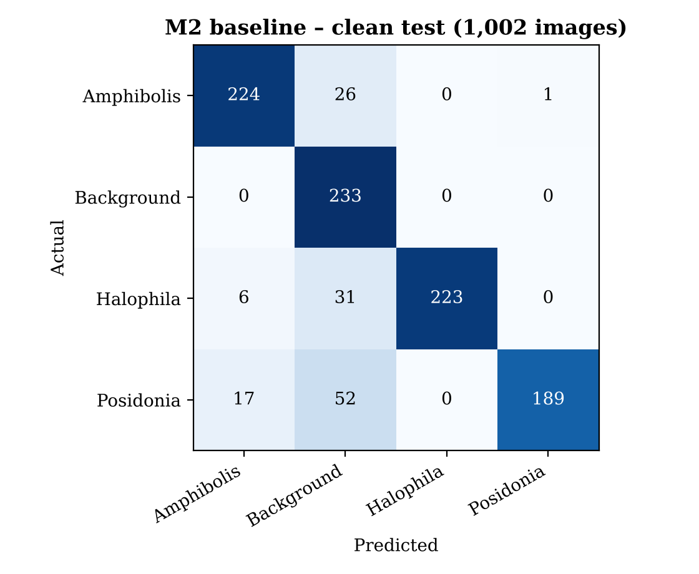
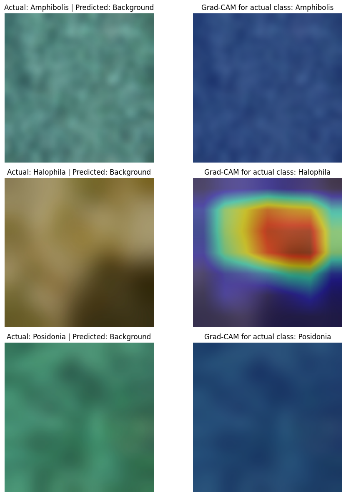
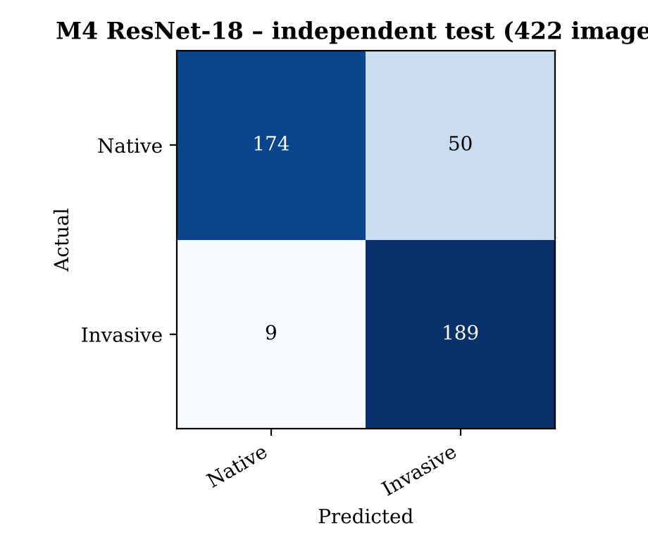
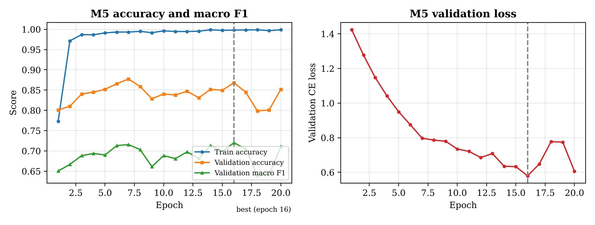
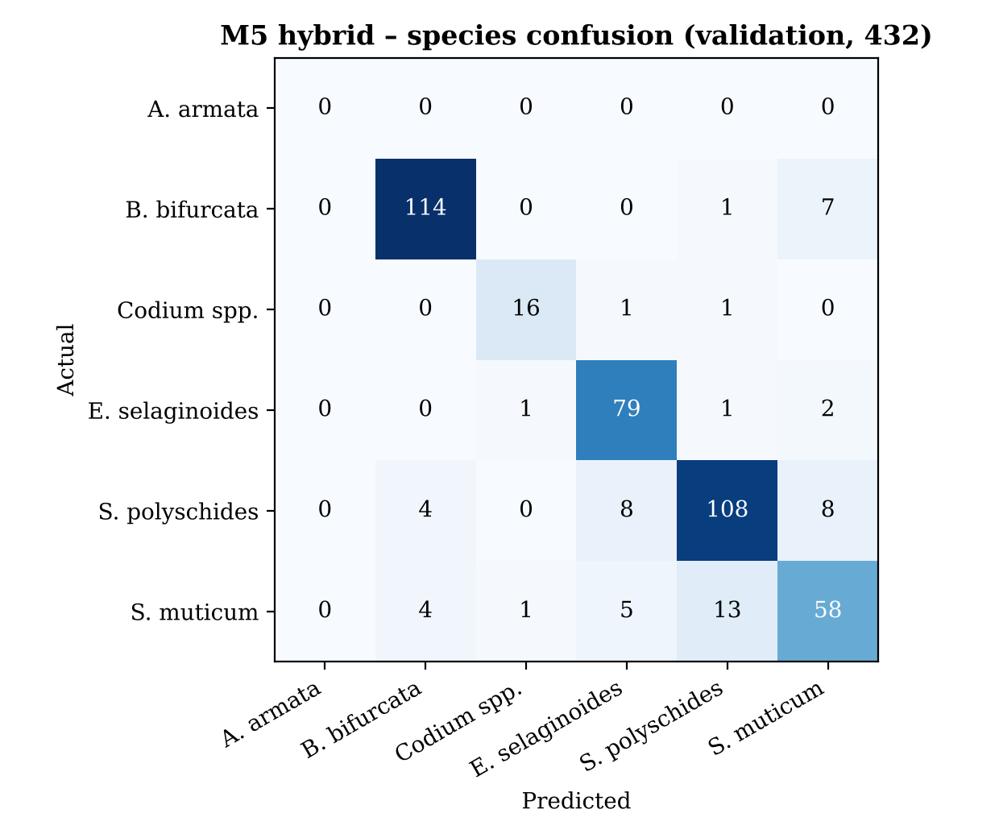
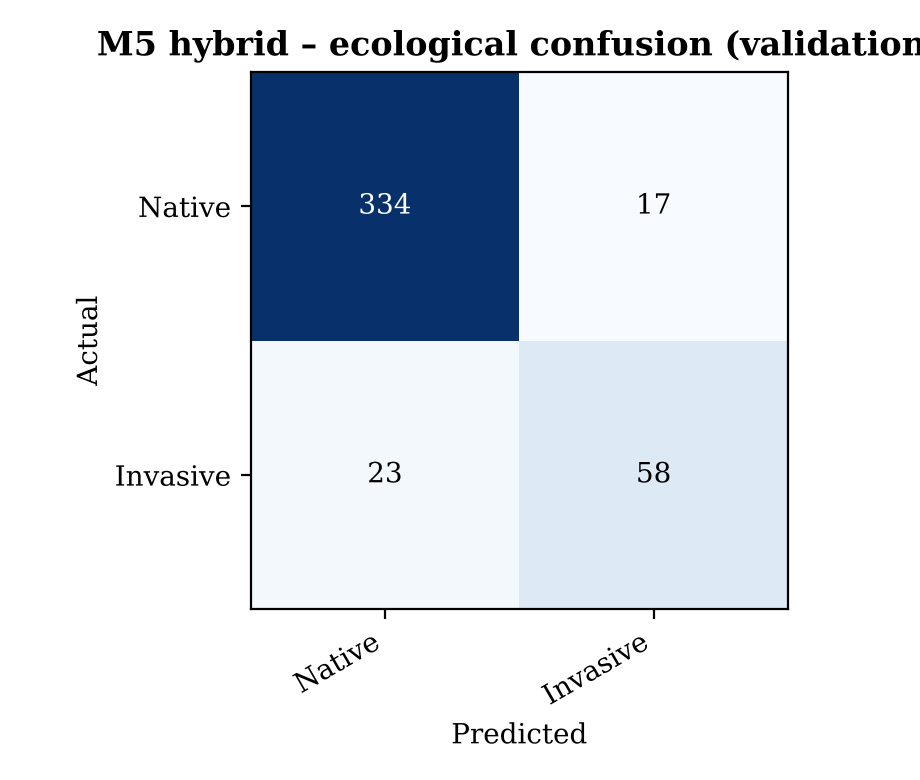
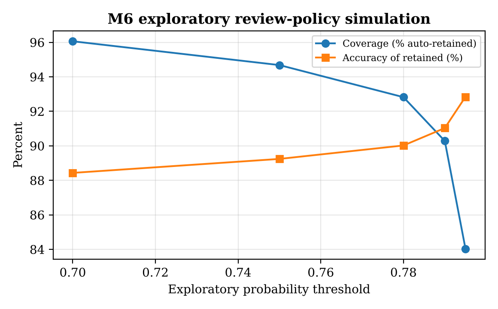

# Results

Validation results (used for model selection) and independent-test results are kept strictly separate.

## M1/M2 - Baseline on ECU-MSS-2

| Stage | Evaluation set | Images | Accuracy | Macro F1 |
|---|---|---|---|---|
| Initial baseline (before audit) | Original test archives | 1,040 | 89.42% | 0.8970 |
| Grouped-v2 baseline | Group-aware validation | 824 | 99.51% | 0.9952 |
| Grouped-v2 baseline | Clean test (deduplicated) | 1,002 | 86.73% | 0.8693 |

Errors are dominated by vegetation predicted as Background (52 Posidonia, 31 Halophila, 26 Amphibolis). Mean confidence
on wrong predictions was 0.909 (max 0.9999): softmax confidence alone is not a safe correctness indicator.

**Image quality:** misclassified images were significantly less sharp (median 0.38 vs 113.8) and lower in contrast
(20.2 vs 34.1) than correct ones (FDR-corrected).

**CLAHE (823 validation images):** original 99.51%, CLAHE clip 2.0 99.03%, clip 1.0 99.27%. Not adopted.

## M3 - Grad-CAM

Top-20% pixel energy: Amphibolis 0.350, Halophila 0.362, Posidonia 0.343 (moderately concentrated, not a mask).

## M4 - Native vs invasive (sealed test, 422 images)

Accuracy **86.02%**, balanced accuracy 0.866, macro F1 0.860.

| Class | Precision | Recall | F1 | Support |
|---|---|---|---|---|
| Native | 0.95 | 0.78 | 0.86 | 224 |
| Invasive | 0.79 | 0.95 | 0.86 | 198 |

| Species | Correct / total | Accuracy |
|---|---|---|
| Asparagopsis armata | 103/103 | 100.00% |
| Sargassum muticum | 86/95 | 90.53% |
| Bifurcaria bifurcata | 43/43 | 100.00% |
| Ericaria selaginoides | 73/74 | 98.65% |
| Saccorhiza polyschides | 58/107 | 54.21% |

83% of the 59 errors came from the native *Saccorhiza polyschides*. *A. armata* had only 21 training images and occurs at a
single location, so its 100% should be read cautiously.

## M5 - Hybrid model (validation, 432 images)

Species accuracy **86.81%**; ecological accuracy **90.74%** (ecological macro F1 0.8435).

| Species | Precision | Recall | F1 | Support |
|---|---|---|---|---|
| Asparagopsis armata | 0.0000 | 0.0000 | 0.0000 | 0 |
| Bifurcaria bifurcata | 0.9344 | 0.9344 | 0.9344 | 122 |
| Codium spp. | 0.8889 | 0.8889 | 0.8889 | 18 |
| Ericaria selaginoides | 0.8495 | 0.9518 | 0.8977 | 83 |
| Saccorhiza polyschides | 0.8710 | 0.8438 | 0.8571 | 128 |
| Sargassum muticum | 0.7733 | 0.7160 | 0.7436 | 81 |

Six-class macro F1 = 0.7203 (includes the zero-support class); about 0.864 over the five present species.
In ecological terms 23 invasive images were predicted native and 17 native images predicted invasive.

**Prototype analysis:** nearest-prototype accuracy equals the classifier (86.81%). Prototype similarity is high even for
wrong predictions (0.946 on average), so it is not a calibrated confidence.

## M6 - Review policy (exploratory, validation data)

| Threshold | Accepted | Sent for review | Coverage | Accuracy of accepted |
|---|---|---|---|---|
| 0.700 | 415 | 17 | 96.06% | 88.43% |
| 0.750 | 409 | 23 | 94.68% | 89.24% |
| 0.780 | 401 | 31 | 92.82% | 90.02% |
| 0.790 | 390 | 42 | 90.28% | 91.03% |
| 0.795 | 363 | 69 | 84.03% | 92.84% |

At 0.795 the ecological accuracy of retained images was 94.77% versus 69.57% for images sent to review; 19 ecological
errors still remain among retained images, which is why human verification stays mandatory.

Machine-readable numbers: [`results/metrics_summary.json`](../results/metrics_summary.json).
